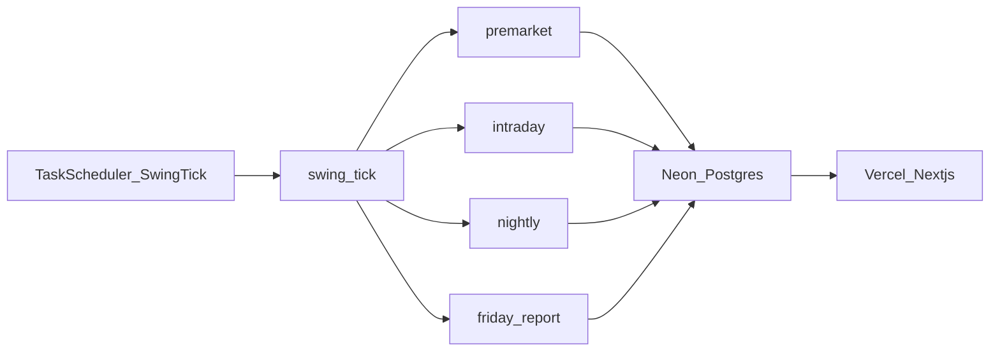
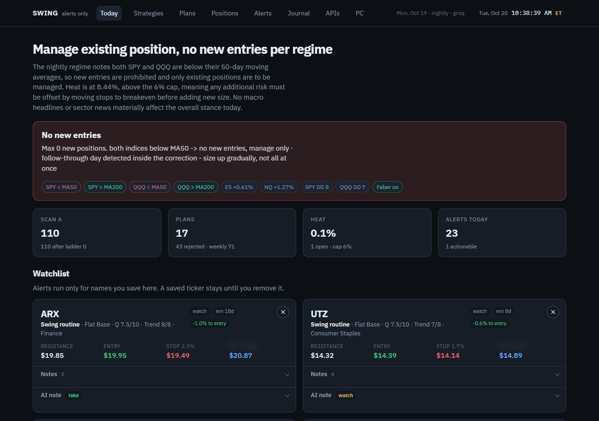
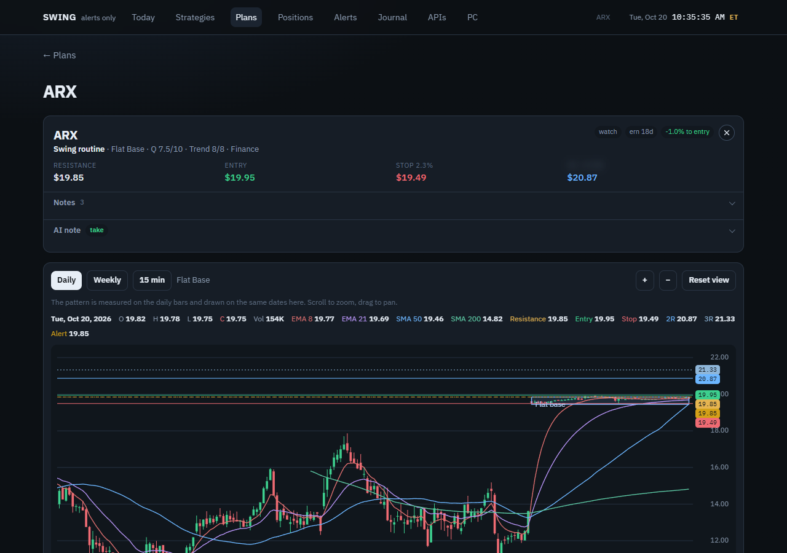
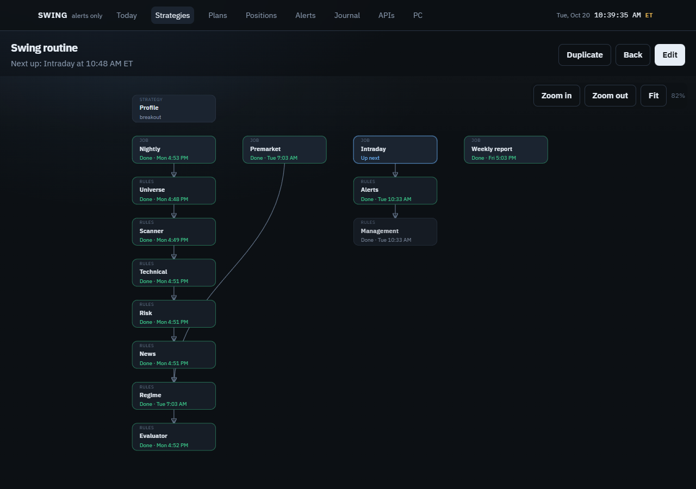
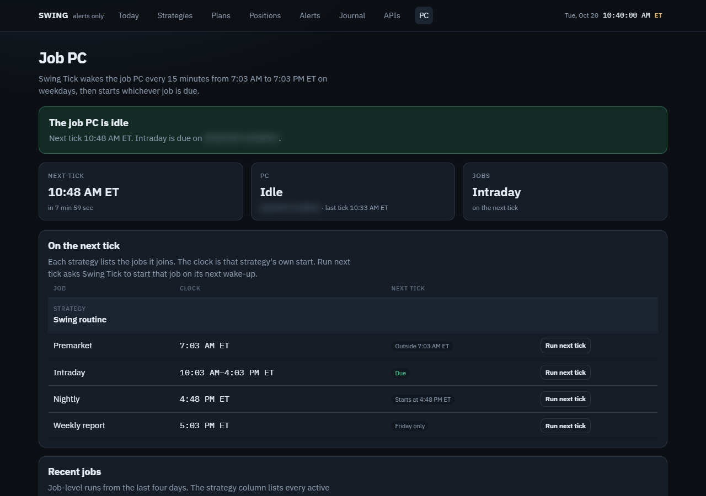

# Swing desk

A personal research desk that turns a written swing-trading routine into a scheduled pipeline and a dashboard. Each evening it screens the market, scores setups, and writes a plan card. During the session it watches those plans and raises alerts. Order entry stays manual.

This is a research project, not a signal service.

## How it runs

A Windows task fires every 15 minutes on weekdays. `swing tick` reads the clocks on strategies whose status is `active` and starts only the job that is due. Results land in Neon. The Next.js app only reads that database.

| Job | When (ET, NYSE days) | What it does |
| --- | --- | --- |
| Premarket | once at 7:03 | Index trend, breadth, macro blackout, sizing for the day |
| Intraday | every 15 min, 10:03–15:48 | Breakout checks on the plan cards, and stop / target checks on open positions |
| Nightly | once after the close | Universe, bars, Scan A, patterns, plan cards, news, prose, charts |
| Report | Friday, off until a strategy turns it on | Expectancy by pattern from the journal |

A once-a-day job does not run again after it succeeds. A failed run is tried on the next tick. Draft and paused strategies do not schedule anything. If two active strategies set different times, the earlier start wins.

## Where it is deployed

- **Dashboard.** Vercel, with the project root set to `web/`. The app only reads Postgres, so the Hobby plan is enough. An optional password gates the UI. The address is not published here.
- **Database.** Neon Postgres. The job PC and the Vercel app share one `DATABASE_URL`. Jobs refuse to start when it is missing.
- **Runner.** One Windows PC that stays logged in and awake. Task Scheduler task name: `Swing Tick`.
- **CI.** GitHub Actions runs the Python tests and a Next.js build on `ubuntu-latest`. It does not run the market jobs.

## How the runner is set up

`scripts/install-tick.ps1` removes the older Premarket, Intraday, Nightly, and Report tasks and registers one weekday task.

- The trigger starts at 7:03 AM Eastern, converted to the PC's local time, then repeats every 15 minutes for 12 hours.
- The task is allowed to wake the PC, start if the PC was asleep at the trigger time, and run only while that user is logged on.
- Each fire runs `scripts/run-tick.ps1`, which calls `uv run swing tick`. `uv` is resolved from `PATH`, not from a user profile path.
- `swing tick` writes a heartbeat row. The dashboard PC page reads it. That is how you can see the machine checked in without opening the PC.

Clocks live on each strategy in the dashboard, not in the scheduled task. Change a start time there; the next tick picks it up.

## What the dashboard shows

Today is the nightly brief: regime, scan counts, and the plan board.

A plan page is the card you would copy into a bracket order, with the chart the nightly job stored.

Strategy clocks are what the runner reads. Only `active` strategies schedule jobs.

The PC page is the heartbeat. It shows whether the last tick ran, and which job is due next.

## Stack

Python 3.12, uv, and Pydantic for the pipeline. Next.js on Vercel for the dashboard. Neon for the journal. Alpaca paper market data for prices. Groq, then Gemini, writes the brief prose; every number comes from code and is checked before it is stored.

Keys stay in `.env` (see `.env.example`). Nothing secret is committed.

Setup for a second machine is in [docs/operations.md](docs/operations.md).
